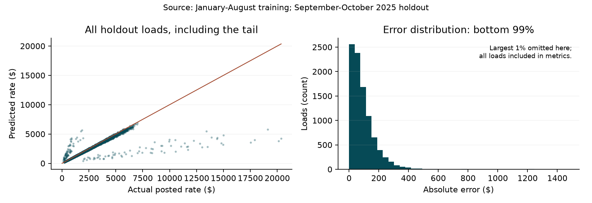
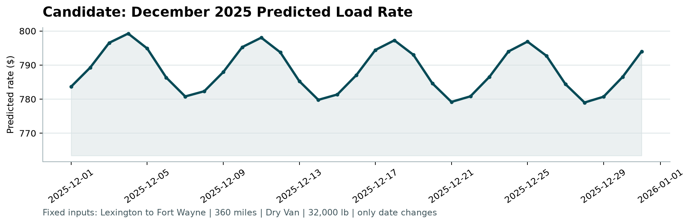

# Freight rate prediction

## Results

I selected Ridge regression on log rates with robust weighting. I compared models on two chronological validation windows, each covering two months. On the September to October evaluation, the selected model achieved a mean absolute error of $146.78 and a weighted absolute percentage error of 6.13%. It reduced mean absolute error by 35.9% compared with the baseline. The baseline multiplies distance by the median rate per mile for the equipment type.

| September to October metric | Selected model | Baseline |
| --- | --- | --- |
| Mean absolute error ($) | 146.78 | 229.10 |
| Root mean squared error ($) | 644.53 | 670.66 |
| Weighted absolute percentage error (%) | 6.13 | 9.58 |
| R-squared | 0.822 | 0.807 |
| Mean signed error: prediction - actual ($) | -122.70 | 40.93 |

## What the results mean

I chose the model with the lowest average absolute dollar error. Most errors were modest, but a few were large. Predictions were too low on average, particularly for some expensive loads. The reported accuracy measures come from September and October. Actual rates for November and December were not provided, so I cannot measure the accuracy of the final predictions.

## 1 Split strategy and validation

The labelled data covers 1 January to 31 October 2025. The prediction inputs cover 1 November to 31 December 2025. Each evaluation trains on earlier months and predicts the next two months. All loads on the same date stay in the same period.

| Purpose | Training period / loads | Future period / loads |
| --- | --- | --- |
| Selection fold 1 | Jan to Apr / 19,110 | May to Jun / 9,696 |
| Selection fold 2 | Jan to Jun / 28,806 | Jul to Aug / 9,671 |
| Final performance check | Jan to Aug / 38,477 | Sep to Oct / 9,523 |
| Submission refit | Jan to Oct / 48,000 | Nov to Dec / 12,000 unlabeled |

### Why I used date splits

A random split would mix earlier and later market conditions in training and evaluation. Date splits test the task we need to solve, predicting later loads from earlier data. They also expose changes in market_index and quote_signal. Each evaluation covers two months to match the final forecast horizon.

### Model selection and evaluation

I compared five models on May to June and July to August. I ranked them by their average absolute dollar error across the two periods, with equal weight for each period. I preferred the simpler candidate when its error was within 2% of the best result. I fixed model settings before evaluating September and October.

I trained the selected model on January to August and evaluated it on September and October. I then retrained it on all labelled data through October to produce the final predictions. September and October did not determine the original model selection, but I had examined their descriptive summaries during exploration. These results are an internal estimate of performance, not a completely independent test.

### Preventing data leakage

The model predicts the rate from load details such as distance, weight, equipment, locations and date. The actual rate, posted_rate, supplies the answer during training. It is not an input feature. Load IDs and prediction columns are also excluded from the inputs.

I fit all preparation rules on each training period. These rules cover missing-value replacements, city coordinates, points used to fit the distance curve, numeric scaling and recognised categories. I apply the rules unchanged to the later evaluation loads. For example, when training on January to April, no May or June rows help determine these rules.

I generate predictions before using evaluation rates to calculate errors. Scores from the two selection windows help choose the model. Evaluation rates do not update its coefficients or preparation rules.

The model does not use a lane's average price or prices from preceding weeks. I therefore did not add a gap between training and evaluation to prevent overlap from historical-price features.

The same route can appear in both periods because the task includes future loads on familiar routes. I also tested loads involving eight cities excluded from training to check how the model handles unfamiliar locations.

## 2 Data audit and preprocessing

| Check | Development | Final prediction inputs |
| --- | --- | --- |
| Rows / unique IDs | 48,000 / 48,000 | 12,000 / 12,000 |
| Missing weight | 300 (0.63%) | 165 (1.38%) |
| Non-positive weight | 292 (0.61%) | 145 (1.21%) |
| Missing market_index | 374 (0.78%) | 249 (2.08%) |
| Exact duplicate rows excluding ID | 0 | 0 |
| Distinct pickup / delivery cities | 64 / 64 | 72 / 72 |

### Cleaning rules

I treat weights of zero or less as missing. I replace missing numeric values with training-period medians and add indicators that record missing inputs. Weight also has an explicit missing-value indicator. I keep all positive rates, including extremes, because the data does not establish whether they are errors. Robust fitting reduces the influence of large training errors without removing loads from evaluation. Dates must be valid. Distances and training rates must be positive, and training rates must be finite.

### New locations and changing inputs

Of the prediction loads, 1,447 involve a pickup or delivery city absent from training. This is 12.06% of the prediction set. Another check found 1,461 loads on directional lanes absent from training. The eight new cities are Allentown, Charlotte, Chicago, Jackson, Knoxville, Laredo, Norfolk and San Diego. Unfamiliar cities receive no learned city-specific adjustment. Coordinates and other inputs still support a prediction. All equipment types appear in training.

The mean market_index falls from about 1.083 in the labelled data to 0.927 in the prediction inputs. This shows a change in the inputs, but does not establish prediction accuracy. The final inputs do not change the training medians, city effects or calendar coefficients.

### Changes in the quote signal

The relationship between quote_signal and actual rates per mile changes across months. It is positive in some months, negative in others and close to zero in August. I compared models with and without the signal. Including it reduced errors in both selection windows, so I kept it. In the final model, an increase of one training standard deviation corresponds to about a 0.48% increase in predicted rate, with other inputs held fixed.

## 3 Model choice and features

The model adds feature contributions to predict the log of the freight rate, then converts the result back into dollars. Ridge uses an L2 penalty to limit large coefficients. Huber-style weights reduce the influence of unusually large prediction errors during training. I refit the model for 12 reweighting rounds, with a Ridge penalty of 10. Predictions have a $1 minimum and no upper cap.

### Model inputs

The model uses log distance, inverse distance and a quadratic spline of log distance with five knots. The spline allows a curved distance effect. Other inputs include weight, log weight, missingness indicators, pickup and delivery coordinates, market_index and quote_signal. Equipment, weekday, pickup city and delivery city each have category indicators. One sine term and one cosine term represent a repeating annual cycle. The model has no unbounded date trend or separate effect for a month absent from training. It has 160 encoded features and no lane-specific interaction, which limits memorisation of sparse routes.

### Model comparison

| Candidate | May to Jun | Jul to Aug | Mean |
| --- | --- | --- | --- |
| Equipment median RPM | 206.18 | 222.73 | 214.46 |
| Ridge log-rate | 134.54 | 153.01 | 143.78 |
| Robust log-rate, no quote | 122.06 | 122.22 | 122.14 |
| Robust log-rate + quote | 108.46 | 110.18 | 109.32 |
| Shallow boosted trees, log-rate | 175.23 | 122.23 | 148.73 |

The robust model with quote_signal had the lowest average mean absolute error, $109.32, and won both selection windows. The boosted trees used the same encoded inputs, 200 iterations, 15 leaves, a learning rate of 0.07, a minimum leaf size of 60 and an L2 penalty of 10. I disabled early stopping to avoid an internal random validation split. The trees did not improve on the robust model in either window, so I chose the simpler model.

### Why I used log rates

Log rates help represent proportional price differences. Robust fitting limits the influence of unusually large training errors. I selected the model by mean absolute error, the average absolute dollar mistake per load. Converting log predictions back into dollars does not guarantee an accurate average rate, and expensive loads may be underpredicted. I applied no overall upward correction. If the goal changes to predicting total expenditure or avoiding very large errors, I would compare models and corrections using that objective.

## 4 Errors and limitations

On September and October, the median absolute error was $72.06. The 90th percentile was $207.94 and the 95th was $273.38. The largest 1% of errors accounted for 35.5% of total absolute error. All loads remain in the reported metrics.

A bootstrap that resamples whole days gives a 95% interval of $131.66 to $162.53 for holdout mean absolute error. I used 2,000 resamples and random seed 42. This interval estimates variation across the 61 observed days for the fitted model. It does not cover unobserved seasonal conditions, new locations or uncertainty from model selection.

| Holdout segment | Loads | MAE ($) | WAPE (%) |
| --- | --- | --- | --- |
| September | 4670 | 134.68 | 5.60 |
| October | 4853 | 158.41 | 6.66 |
| Dry Van | 5360 | 140.87 | 6.18 |
| Flatbed | 1770 | 150.38 | 6.16 |
| Reefer | 2393 | 157.34 | 6.04 |

For a separate test, I removed all January to June loads involving eight selected cities, then trained on the remaining loads and evaluated July and August. Mean absolute error was $111.75 for 2,234 loads involving excluded cities and $110.39 for 7,437 other loads. The similar errors suggest the model can transfer to unfamiliar cities, but the groups contain different loads and the test covers only eight cities. It does not establish accuracy in the eight new cities in the final inputs. The excluded cities were Albany, Birmingham, Dallas, Greensboro, Lexington, Mobile, Providence and Shreveport.

## 5 December predictions

These 31 predictions keep the route, distance, equipment and weight fixed. The route is Lexington to Fort Wayne, the distance is 360 miles, the equipment is Dry Van and the weight is 32,000 lb. Predictions range from $779.00 to $799.24, with a mean of $788.56. Only the date changes. The curve follows the learned weekday and annual cycle effects. The training data contains no December labels, and the model has no learned Christmas-specific effect. Actual December prices may follow a different pattern.

### Predicting with fewer inputs

The December file lacks coordinates, market_index and quote_signal. I trained a companion robust model on all 48,000 labelled loads without the two signals. It recovers coordinates for known cities from training-only lookups. I tested the same reduced input format on September and October. It achieved a mean absolute error of $165.83 and a weighted absolute percentage error of 6.93%. This tests the effect of fewer inputs on historical loads. It does not measure December accuracy.
